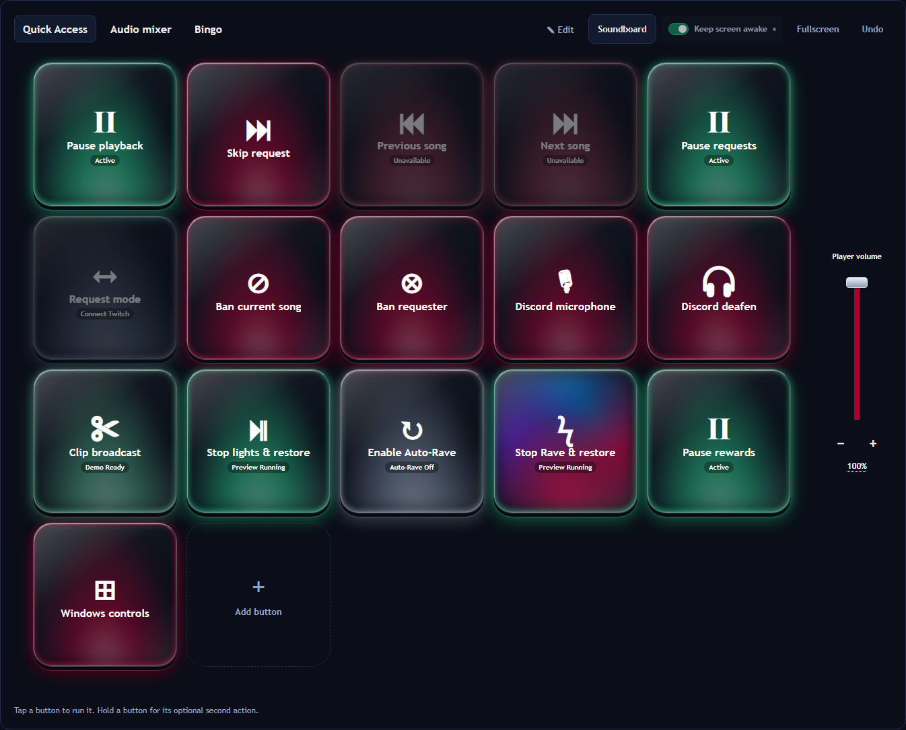
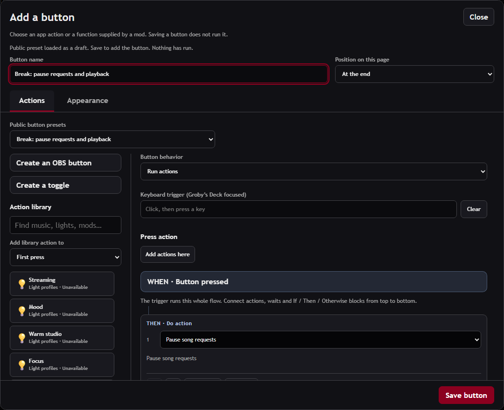
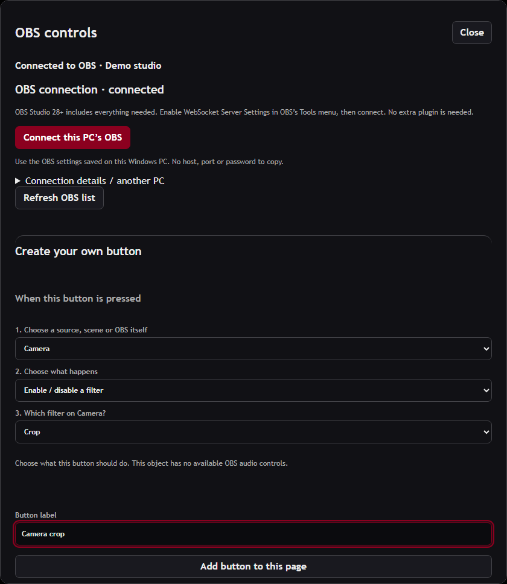
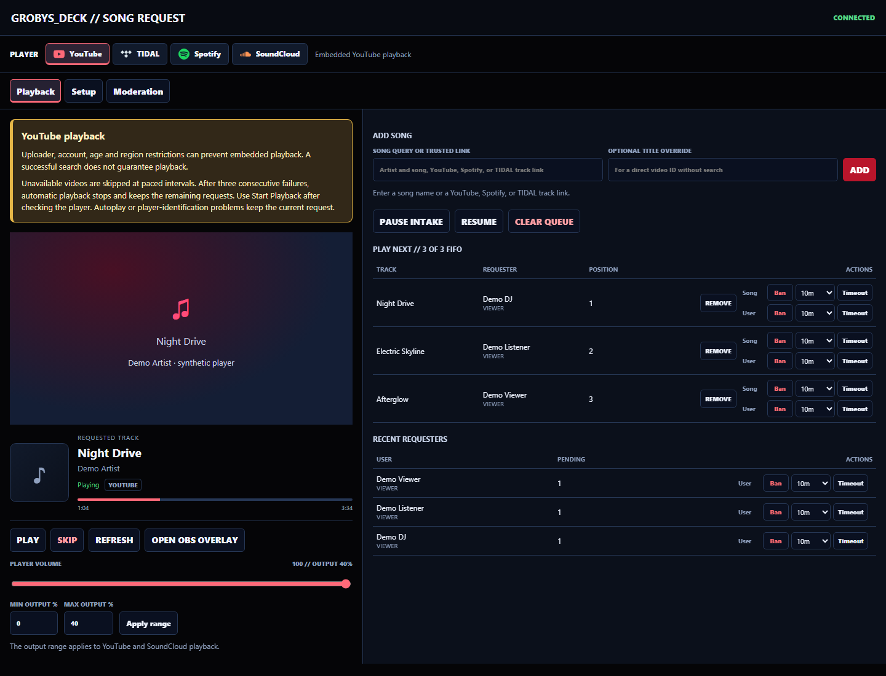
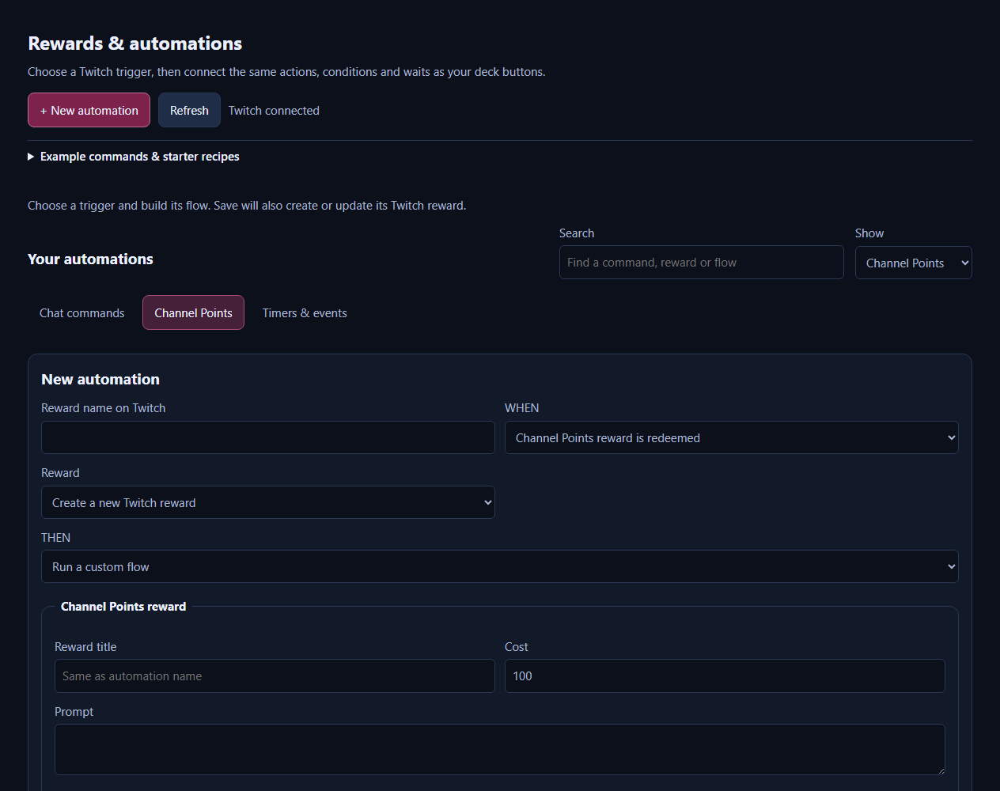

# Groby’s Deck

**Your stream. Your controls. Your deck.**

Build a modular control surface for your stream, desktop, phone or tablet:

- **Button decks:** music, audio mixers, OBS scenes, microphones, lights and custom actions.
- **Twitch automations:** chat commands, Channel Points rewards, timers, raids and subscriber events.
- **Flow builder:** combine actions, conditions, waits, repeats and temporary changes you can restore.
- **Overlay designer:** named layouts, editable layers, animated widgets, chat and song information.
- **Song requests:** shared moderation for supported music players and Twitch request sources.
- **Smart lighting:** Hue, WiZ and Govee LAN controls, saved scenes and Music-to-Light.

Runs locally on Windows with bundled Twitch Integration and Song Request. Your settings and account credentials stay on your PC.

[Download the latest release](https://github.com/NameSRoby/Groby-s-Deck/releases/latest) |
[User guide](docs/USER_GUIDE.md) |
[Report a bug](https://github.com/NameSRoby/Groby-s-Deck/issues/new?template=bug_report.yml)

## Install

1. Download the Windows setup installer.
2. Run Setup. Twitch Integration and Song Request are selected by default.
3. Open **Groby’s Deck** from the Start menu or desktop shortcut.

**Portable:** extract the self-contained Windows ZIP completely, then run **Groby's Deck.exe**.
First launch installs the bundled Twitch Integration and Song Request packages offline.

The runtime and feature packages are included. No developer tools are needed.
Your account sign-ins and online music services still need internet.

Windows requirements and other installation options

- **Windows 10 x64, build 19041 or later**, or Windows 11.
- Music-to-Light app capture needs **build 20348 or later**; Windows 11 is recommended.
- Setup detects WebView2 and runs its bundled offline Evergreen installer only
  when it is missing. Portable users can run **scripts/install-webview2.ps1**.
- The release is unsigned, so Windows may show an unknown-publisher warning.
  Compare downloads with **SHA256SUMS.txt**.
- **Code > Download ZIP** downloads source code. Run **Start-Grobys-Deck.cmd** for
  first-time source setup; it downloads a verified runtime bundle.
- Use a separate folder from an old RaveLink Bridge installation.

[Windows setup guide](docs/WINDOWS_SETUP.md) |
[Source setup](docs/USER_GUIDE.md#source-and-tests)

## Start here

| Want to...                  | Open                                         |
| --------------------------- | -------------------------------------------- |
| Connect your lights         | **Fixtures**                                 |
| Make lights follow music    | **Lights > Music-to-Light > Audio & lights** |
| Add Twitch or song requests | **Packages**                                 |
| Customize your controls     | **Dashboard > Button deck > Edit**           |
| Use your phone or tablet    | The **network icon**                         |

Core opens in its own desktop window. You can also use
[localhost:5050](http://127.0.0.1:5050) in a browser.
Closing the window keeps Core in the tray; **Groby’s Deck > Exit** stops it.

## Build your button deck

Put your most-used controls on one screen:

- **Music:** playback, volume and request moderation.
- **Lights:** colors, saved profiles and Rave controls.
- **OBS:** scenes, source visibility, microphones and filters.
- **Custom actions:** keyboard shortcuts, macros and approved mod functions.

Press **+** to add a button. Use **Edit** to move it or change its appearance.
Add pages and folders when you need more space.

Choose icons, text, images, GIFs and backlight colors.
Use **Fullscreen** for a dedicated control surface on desktop, phone or tablet.

The screenshots show 0.8.2b in the default **Midnight** theme. Connected examples
use demo data. New decks use rounded acrylic buttons with crimson backlighting
and icons with text.

[Button deck setup and customization](docs/CONTROL_DECK.md)

See the public button presets

See the OBS button builder

Connect through **OBS connection**, then choose **Create an OBS button** in the
button editor. OBS 28+ includes the required WebSocket server.

[OBS setup](docs/CONTROL_DECK.md#obs-buttons)

### Send soundboard audio to a microphone input

Install a VB-CABLE recording and playback pair. In **Soundboard** or a **Play sound file** action, select the **Virtual mic** destination. Select the matching recording device in OBS, Discord or the receiving app. Select headphones as a second destination to hear the clip locally. To combine your physical microphone and soundboard on one input, route both through a virtual mixer such as Voicemeeter.

## Make your lights follow music

1. Open **Audio & lights** and choose your audio source and lights.
2. Allow capture and light output, then calibrate at your usual listening volume.
3. Open **Play**, choose an effect profile and preview it.

Choose matching, custom or random colors. Use **Create** for detailed tuning
and saved effects.

[Music-to-Light guide](docs/USER_GUIDE.md#music-to-light) |
[Hue setup](docs/USER_GUIDE.md#hue-entertainment-setup) |
[Govee compatibility](docs/USER_GUIDE.md#govee-lan-compatibility)

## Take song requests

Open **Song Request**, choose a player and follow its Setup page.

Manage requests, moderate viewers and songs, organize playlists, review transfers
and design a now-playing overlay for OBS.

| Player     | How it connects                                      |
| ---------- | ---------------------------------------------------- |
| YouTube    | Search and official embedded playback                |
| SoundCloud | Public search and official widget playback           |
| Spotify    | Desktop companion; optional Premium account controls |
| TIDAL      | Signed-in catalog and desktop companion              |

Availability, accounts, ads and playback restrictions depend on the provider.
Desktop companions may need updating after player changes.

[Player setup and limitations](docs/USER_GUIDE.md#optional-features) |
[Playlists and transfers](docs/USER_GUIDE.md#playlists-and-transfers)

See the overlay designer

Select an object, adjust its layout and choose **Save overlay** to apply changes to OBS. The Twitch chat widget mirrors message deletions, bans, timeouts and chat clears in both the editor and OBS. Open the widget's **Content** settings to control username colors, Twitch badges and emotes from Twitch, 7TV, BetterTTV and FrankerFaceZ.

## Connect Twitch

Open **Twitch Integration** and connect your account.
Choose which permissions you want before signing in.

You can enable:

- Song requests through Channel Points or **!sr / !songrequest**.
- Viewer lighting commands and Rave.
- Chat replies and stream clipping.

Core-managed song rewards stay refundable until playback is confirmed.
Widget-only intake requires manual refunds and fulfillment.

See Twitch permission settings

Permission changes apply to your next sign-in. Unchecking an option does not
revoke permissions already granted on Twitch.

[Community playlist rewards](docs/USER_GUIDE.md#community-playlist-reward)

See Twitch automations and built-in features

## Use a phone or tablet

Click the **network icon** to enable access on your private network.
Scan the QR code or copy the link to your other device.

Private-network access gives that device full controls.
The desktop window and localhost remain available.

## What's new in 0.8.22

- Spotify queue replies show known requests while other deliveries are pending. Numbered commands follow the displayed queue, and skip targets the current song.
- SoundCloud queue replies distinguish loading tracks from playing tracks and use SoundCloud’s own queue positions.
- Request limits can be edited from every player and apply to Twitch chat and Channel Points. The defaults are five pending requests per viewer and ten per VIP, with no per-user limit for moderators.
- Fresh Song Request setups enable all chat responses except automatic now-playing announcements. Upgrades keep saved preferences.

## What's new in 0.8.21

- Challenge boards have adjustable grid dimensions, per-tile images and one-click sizing for the whole board.
- Saved game boards open in fullscreen Button Deck. Syntax & examples uses the app theme and available width.
- Core Updates downloads, verifies and installs in one step from the Windows app. Setup can upgrade or repair an existing installation in its original folder.

## What's new in 0.8.2c

- **Workspace layout** profiles adjust controls, typography, rows and spacing across the app. Preview Compact, Spacious or Side navigation in **Choose Tabs**. Normal is the default.
- **Overlay Designer** and the OBS browser source share the saved board appearance. Bingo supports board and square images, completion colors and symbols, and configurable announcements. Challenge boards support freely placed tiles. Tile Match adds a memory game.
- **Game commands** let the broadcaster assign each command to moderators, VIPs or viewers for a selected saved game. Try `!complete <square name>` for Bingo or a Challenge board.
- **Song Request** has a dedicated **Chat Responses** tab. Spotify reconnects to Core, reconciles confirmed handoffs after restart, and keeps uncertain writes available for review.
- **Twitch Connection** supports selecting or clearing all optional features and shows how many are selected.

## What's fixed in 0.8.2b

- Fresh installations provision the Twitch Integration and Song Request packages from the bundle.
- Public automation examples and button presets are visible before account setup.
- **Built-in features** has its own tab under **Rewards & automations**. Enabled features with no reward binding can fall back to chat commands.
- Turn off watchtime tracking in **Watchtime & points** or disable Twitch quote commands in **Quotes**. Both settings keep existing records.
- Song Request's saved chat mode takes precedence, with mode switching and pause controls preserved.
- Keeps public presets and profiles, and fixes selected source cards and room-layout colors across every app palette.
- Tracks setup in a compact dismissible progress bar, with persistent per-feature skips. Lighting starts with pairing and fixture assignment.
- Gives slow settings reads time to complete and shows private-data-free startup reports.
- Keeps the reduced end-user regression inventory and existing companion, privacy and security fixes.

[Setup and public presets](docs/SETUP_AND_PRESETS.md)

[Desktop companion compatibility and remaining acceptance](docs/COMPANION_COMPATIBILITY.md)

Update the optional **Song Request** and **Twitch Integration** packages under **Packages & updates** to use their latest features.

[Command language](docs/COMMAND-VARIABLES.md) | [Twitch automations](docs/TWITCH_AUTOMATIONS.md) | [Earlier releases](docs/RELEASE_ARCHIVE.md)

## Things to know

- Light features depend on the model, firmware and network. Hue Entertainment
  needs pairing and an area; compatible Govee lights need LAN Control enabled.
- Protected audio may be unavailable. Browser capture does not isolate individual tabs.
- Stop and normal shutdown attempt to restore your lights. A crash, power loss or
  disconnected device can prevent restoration.
- Community mods are third-party code. Review them before activation.

Screenshots use demonstration data and simulated connections.
Automated tests cannot certify every device or account.

[User guide](docs/USER_GUIDE.md) |
[Validation and known limits](docs/REPOSITORY_HEALTH.md)

## Privacy and updates

Settings, credentials, pairings, playlists and logs stay on your PC and are
excluded from published downloads. Services you enable still use the internet.

Updates verify checksums and preserve local data.
Optional packages update separately under **Packages**.

When reporting a bug, include your versions and steps to reproduce it.
Remove tokens, account details and private paths from screenshots and logs.

## Developers and contributors

[Contributing](CONTRIBUTING.md) |
[Developer guide](docs/DEVELOPMENT.md) |
[Mod author guide](docs/MOD_AUTHOR_GUIDE.md) |
[Mod APIs](docs/MOD_API_REFERENCE.md) |
[Application APIs](docs/API_REFERENCE.md) |
[Mod starter](packages/mod-sdk/starter)

## License

Apache-2.0. Third-party code and provider marks retain their own licenses.
See [LICENSE](LICENSE) and [THIRD_PARTY_NOTICES.md](THIRD_PARTY_NOTICES.md).

## Earlier versions

Previous releases remain available in the
[release archive](docs/RELEASE_ARCHIVE.md) for reference.

Existing settings, secrets, mods and automation data are preserved when upgrading in the same folder.
The internal `ravelink` protocol and storage names remain stable so existing integrations continue to connect.
