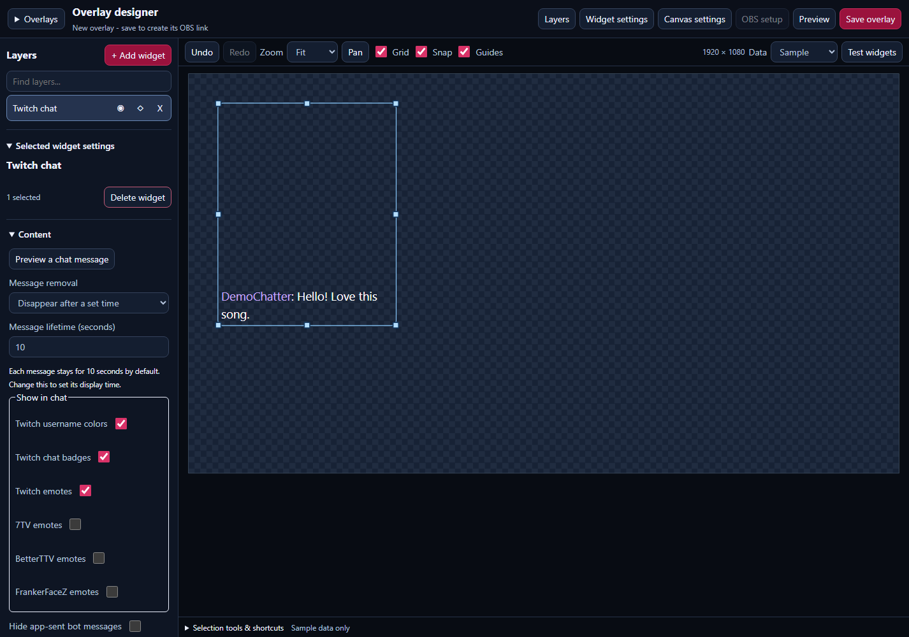

# Groby’s Deck

Groby’s Deck is a local Windows control surface for streaming. Build button decks for OBS, audio and lights, automate Twitch rewards and chat, take song requests, and design overlays for OBS.

[Download 0.8](https://github.com/NameSRoby/Groby-s-Deck/releases/tag/v0.8) · [User guide](docs/USER_GUIDE.md) · [Report a bug](https://github.com/NameSRoby/Groby-s-Deck/issues/new?template=bug_report.yml)

## Install and get started

Run **Grobys-Deck-Windows-v0.8-setup-installer.exe**, then open **Groby’s Deck**. For portable use, extract **Grobys-Deck-Windows-v0.8-self-contained.zip** and run **Groby's Deck.exe**. Windows 10 x64 build 19041 or later is required. Setup includes an offline WebView2 installer for systems that need it. [Windows setup and upgrades](docs/WINDOWS_SETUP.md)

| To                                         | Open                                                  |
| ------------------------------------------ | ----------------------------------------------------- |
| Build stream controls                      | **Dashboard → Button deck → Edit**                    |
| Install Twitch Integration or Song Request | **More → Updates & packages**                         |
| Review and manage mods                     | **More → Updates & packages → Mods**                  |
| Design a full scene for OBS                | **Overlay designer**                                  |
| Connect lights                             | **Fixtures**                                          |
| Match light effects to music               | **Lights → Music-to-Light**                           |
| Use your phone or tablet                   | The **network icon** to enable private-network access |

The desktop window and [local browser interface](http://127.0.0.1:5050) share the same controls. Closing the window keeps the app in the tray. Use **Groby’s Deck → Exit** to stop it.

## Button deck

Create pages for OBS, app volume, music, lights and soundboard clips. Build timed sequences with conditions and waits, edit button appearance separately, and use **Fullscreen** on a desktop, phone or tablet. Soundboard buttons can route an MP3 or WAV to multiple Windows outputs, including the playback side of a virtual microphone cable. [Deck and soundboard guide](docs/CONTROL_DECK.md)

## Twitch automations

Create chat commands, Channel Points rewards, timers and responses to events like raids and subscriptions. The Twitch workspace also includes a command list generator, syntax reference, editable quotes and watchtime settings.

[Twitch automations](docs/TWITCH_AUTOMATIONS.md) · [Command language](docs/COMMAND-VARIABLES.md) · [Editable d20 arena](docs/d20-arena.md)

## Overlay designer

Arrange and style layers on a full-scene canvas. Preview live chat and supporter data, or test with sample data before adding the saved overlay to OBS. Twitch chat mirrors moderation events and offers separate controls for username colors, badges, and Twitch, 7TV, BetterTTV and FrankerFaceZ emotes. [Overlay designer guide](docs/OVERLAY-DESIGNER.md)

## Song Request and lights

- **Song Request** supports YouTube, SoundCloud, TIDAL and Spotify with shared request moderation. Use **Song Request → Overlay Designer** to customize the standalone now-playing card. [Player setup, queues and transfers](docs/USER_GUIDE.md#optional-features)
- **Lights** supports compatible Hue, WiZ and Govee devices. In **Music-to-Light**, choose a capture source, calibrate at your usual volume and preview an effect before starting output. [Music-to-Light setup](docs/USER_GUIDE.md#music-to-light)

See Song Request and Music-to-Light

Screenshots use demonstration data and simulated connections. Account credentials and settings are stored locally. Online services you enable still need internet access. [Privacy and updates](docs/USER_GUIDE.md#updates-privacy-and-uninstall)

## Build and extend

[Application API](docs/API_REFERENCE.md) · [Mod API](docs/MOD_API_REFERENCE.md) · [Mod author guide](docs/MOD_AUTHOR_GUIDE.md) · [Mod starter](packages/mod-sdk/starter) · [Developer guide](docs/DEVELOPMENT.md) · [Contributing](CONTRIBUTING.md)

[0.8 release notes](https://github.com/NameSRoby/Groby-s-Deck/releases/tag/v0.8) · [Earlier releases](docs/RELEASE_ARCHIVE.md) · [Apache-2.0 license](LICENSE) · [Third-party notices](THIRD_PARTY_NOTICES.md)
